# Modelo Entidad-Relacion — InkaQuest

Diagrama ER del esquema implementado en Supabase. Refleja exactamente las 121
tablas creadas por las migraciones.

## 1. Panorama general

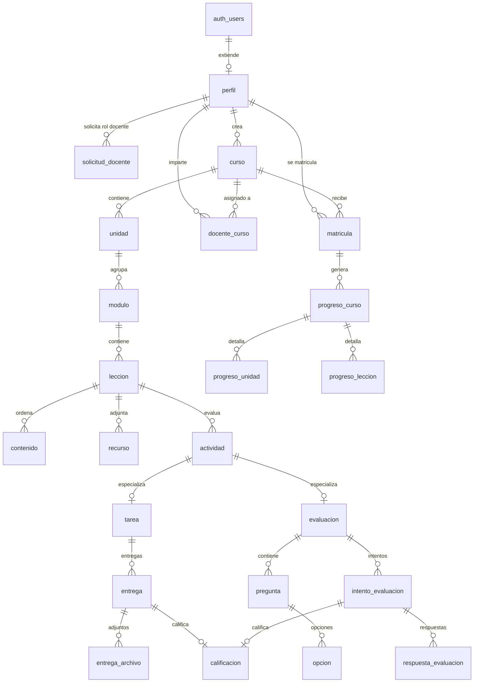

## 2. Módulo A — Identidad y seguridad

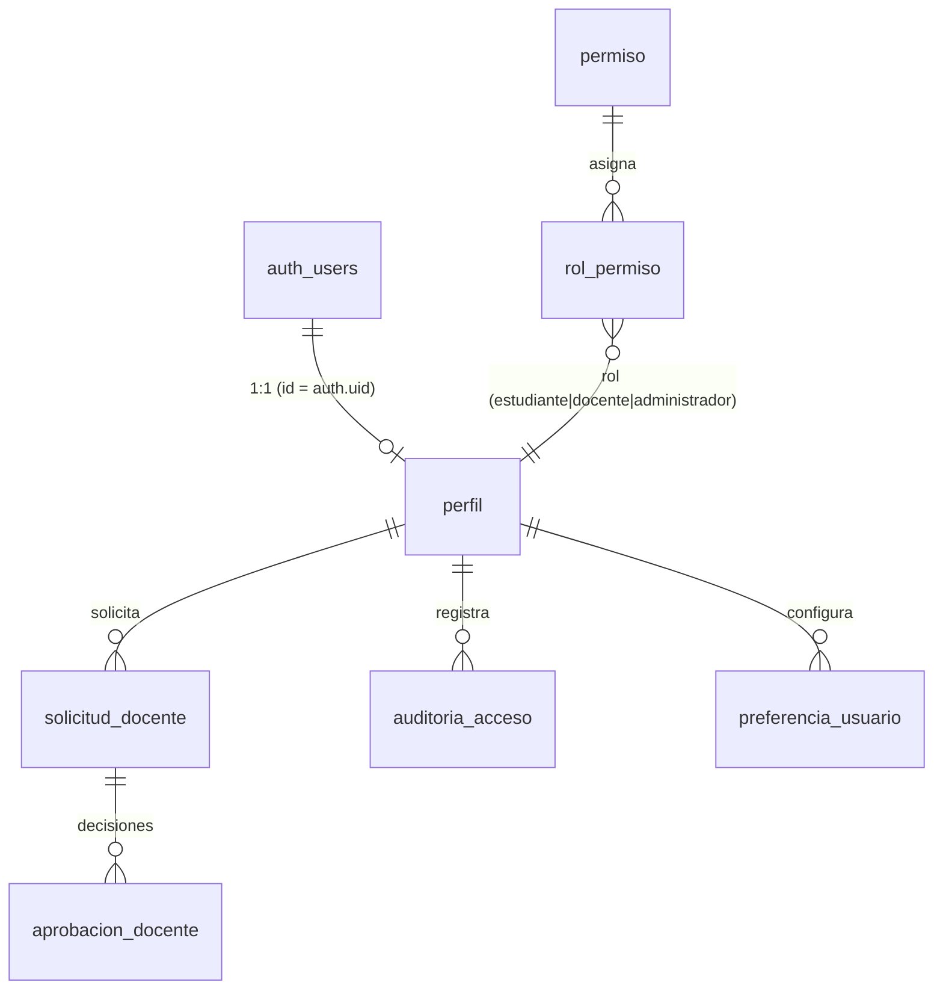

**Puntos clave**

- `perfil.id` **es** `auth.users.id`: no hay tabla de usuarios paralela ni
  contraseñas duplicadas.
- El rol por defecto de `perfil` es `estudiante`. El registro público nunca
  crea docentes ni administradores.
- `aprobacion_docente` conserva el histórico de cada decisión sobre una
  solicitud.

## 3. Módulo B — Gestión académica

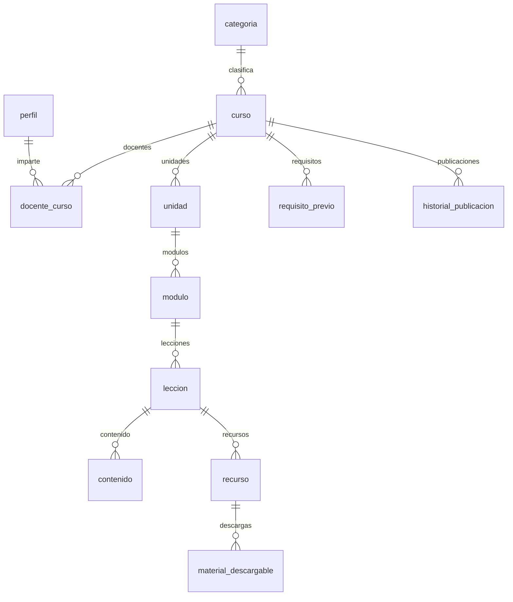

`curso` referencia a sí mismo mediante `requisito_previo`, con la restricción
`curso_id <> curso_requisito_id` que impide el auto-requisito.

## 4. Módulo C — Matrículas

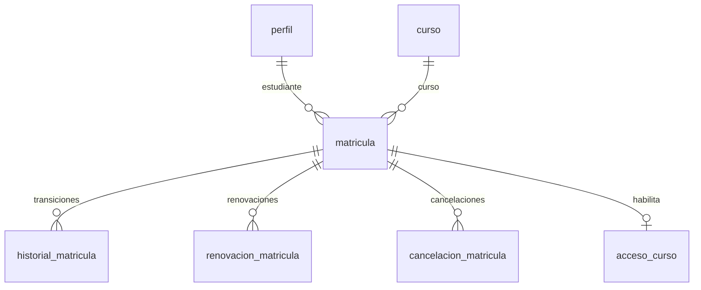

`unique (estudiante_id, curso_id)`: una sola matrícula por estudiante y curso.

## 5. Módulo D — Pagos y comercio

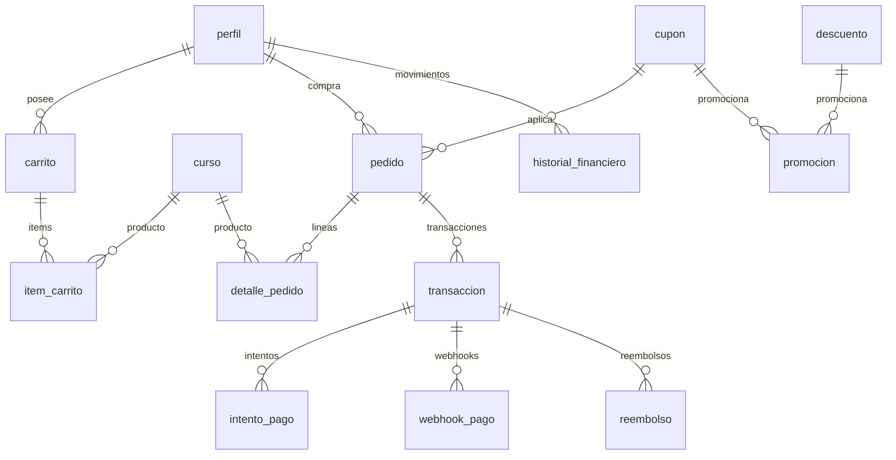

**Reglas de integridad**

| Regla | Implementación |
|---|---|
| Idempotencia del pedido | `pedido.clave_idempotencia` UNIQUE |
| Idempotencia del cobro | `transaccion.clave_idempotencia` UNIQUE |
| Idempotencia del webhook | `webhook_pago.evento_id` UNIQUE |
| La matrícula solo se activa con pago | Trigger `fn_activar_matricula_tras_pago` |
| Sin datos de tarjeta | Solo `referencia` y `codigo_autorizacion` (tokens opacos) |

## 6. Módulo E — Progreso académico

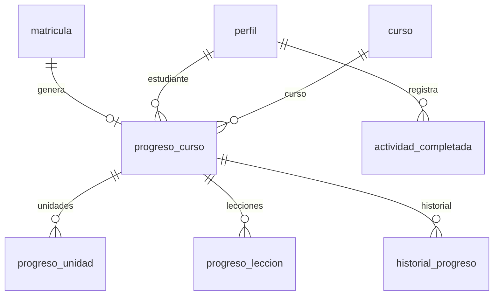

`fn_registrar_completado_leccion()` recalcula los tres niveles de progreso de
forma transaccional e idempotente.

## 7. Módulo F — Actividades y evaluaciones

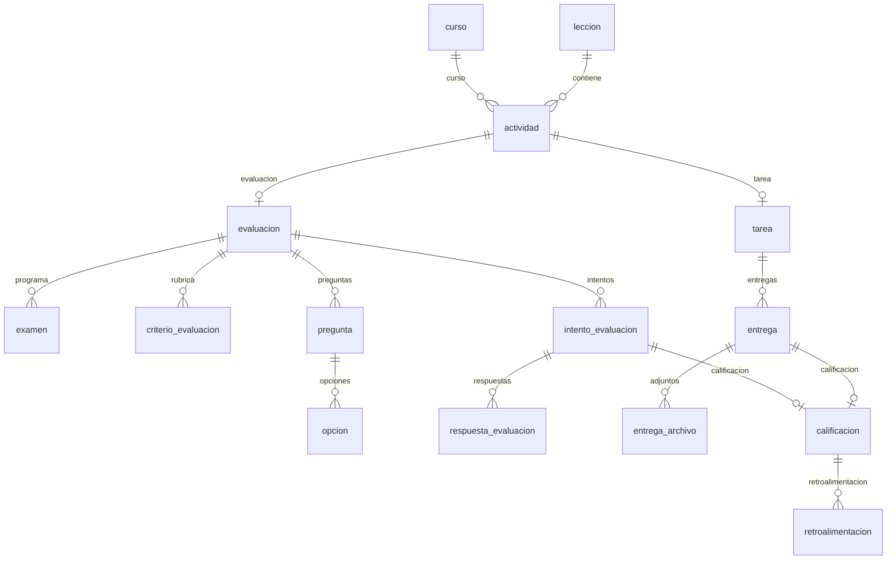

**Datos protegidos**: `opcion.es_correcta` y `pregunta.es_privada` solo son
legibles por el docente del curso o un administrador (ver
[MATRIZ-RLS.md](MATRIZ-RLS.md)).

`calificacion` tiene `check (num_nonnulls(entrega_id, intento_id) = 1)`: una
calificación corresponde a una entrega **o** a un intento, nunca a ambos.

## 8. Módulo G — Retos de programación

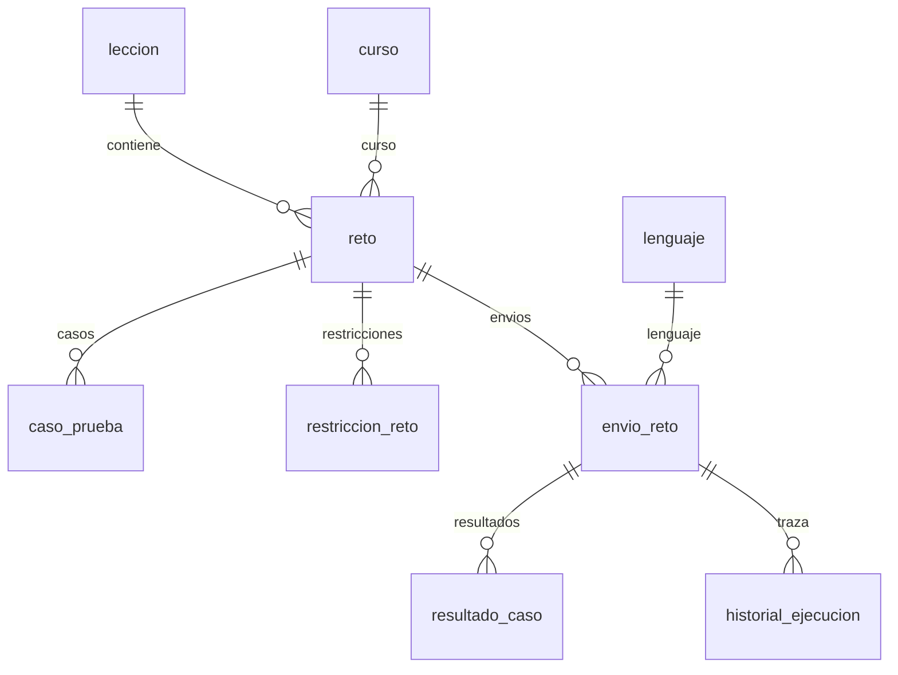

`caso_prueba.es_oculto = true` protege la solución: el estudiante solo ve los
casos marcados como `es_ejemplo`.

## 9. Módulo H — Motores de minijuegos

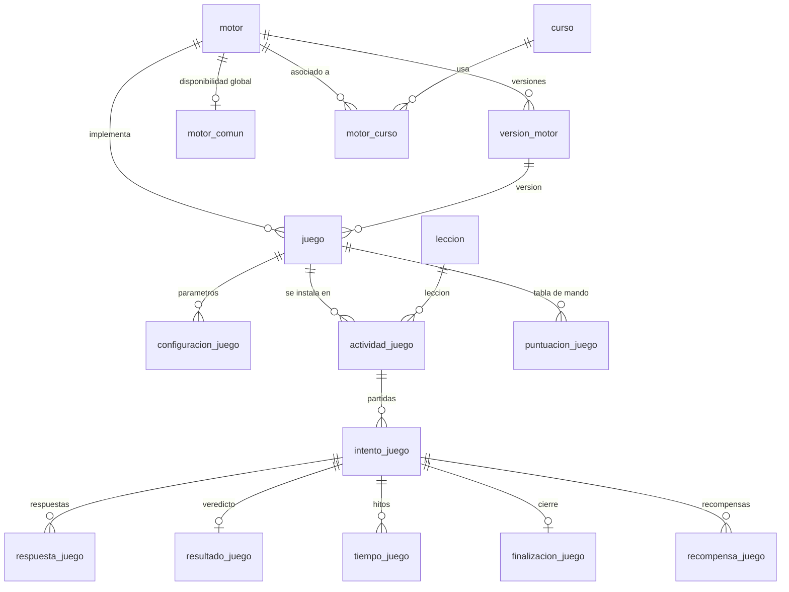

**Separación de conceptos** (clave para no confundir):

| Concepto | Tabla | Función |
|---|---|---|
| Motor | `motor` | El framework que ejecuta juegos. Sin datos de juego. |
| Versión | `version_motor` | Una versión concreta del motor. |
| Común o específico | `motor_comun` / `motor_curso.es_comun` | Disponibilidad global o por curso. |
| Juego | `juego` | Un juego concreto dentro de un motor. |
| Configuración | `configuracion_juego` | Datos (clave/valor) que definen la partida. |
| Actividad | `actividad_juego` | El juego instalado en una lección. |
| Intento | `intento_juego` | Una partida empezada. |
| Respuesta | `respuesta_juego` | Lo que el usuario contesta. |
| Resultado | `resultado_juego` | Puntaje, precisión, completitud. |
| Recompensa | `recompensa_juego` | Lo que otorga la partida. |

**Extensibilidad**: agregar un motor nuevo requiere solo insertar en `motor`
y `version_motor`. No hay que alterar el modelo: `configuracion_juego` (JSONB)
absorbe las particularidades de cada juego.

## 10. Módulo I — Gamificación

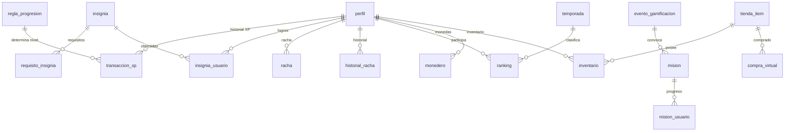

`transaccion_xp` es un **libro mayor append-only**: permite auditar de dónde
sale cada punto.

## 11. Módulo J — Certificados

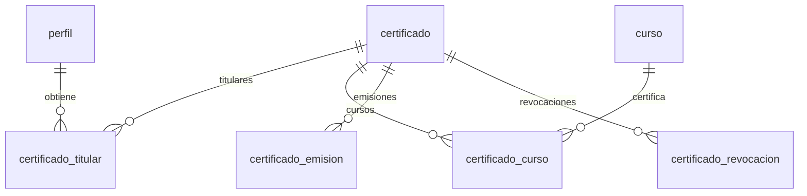

`certificado.codigo` es único y sirve como código de verificación pública.

## 12. Módulo K — Notificaciones y soporte

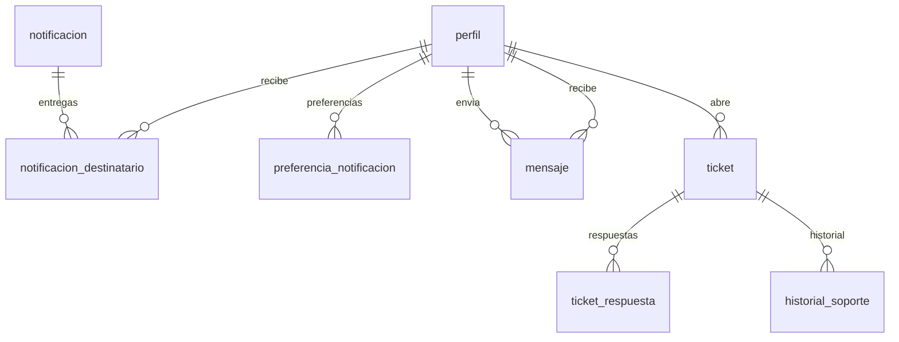

## 13. Módulo L — Chatbot

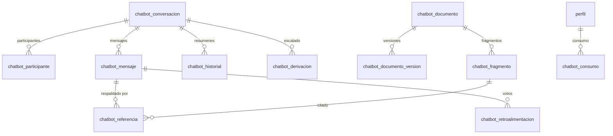

`chatbot_fragmento.embedding` es `vector(1536)` cuando pgvector está
disponible; si no, la búsqueda funciona por trigram sobre `tokens`.

## 14. Módulo M — Auditoría y configuración

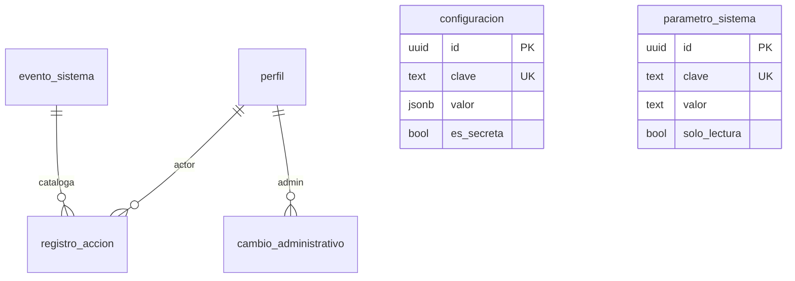

`registro_accion` guarda `valor_anterior` y `valor_nuevo` en JSONB, lo que
permite reconstruir el estado anterior de cualquier entidad.

## 15. Convenciones aplicadas

| Convención | Detalle |
|---|---|
| Claves primarias | `uuid` con `gen_random_uuid()` (pgcrypto) |
| Claves foráneas | `on delete cascade` en dependientes, `set null` en referencias débiles, `restrict` en lo que no se debe borrar |
| Fechas | `timestamptz` con `default now()` |
| Dinero | `numeric(10,2)` con `check (>= 0)` |
| Estados | Tipos ENUM nativos (38 definidos) |
| Booleanos | `boolean not null default ...` |
| JSONB | Solo cuando la estructura es abierta (`configuracion_juego`, `datos`, `variables`) |
| Timestamps de auditoría | `creado_en` y `actualizado_en` con trigger automático |
