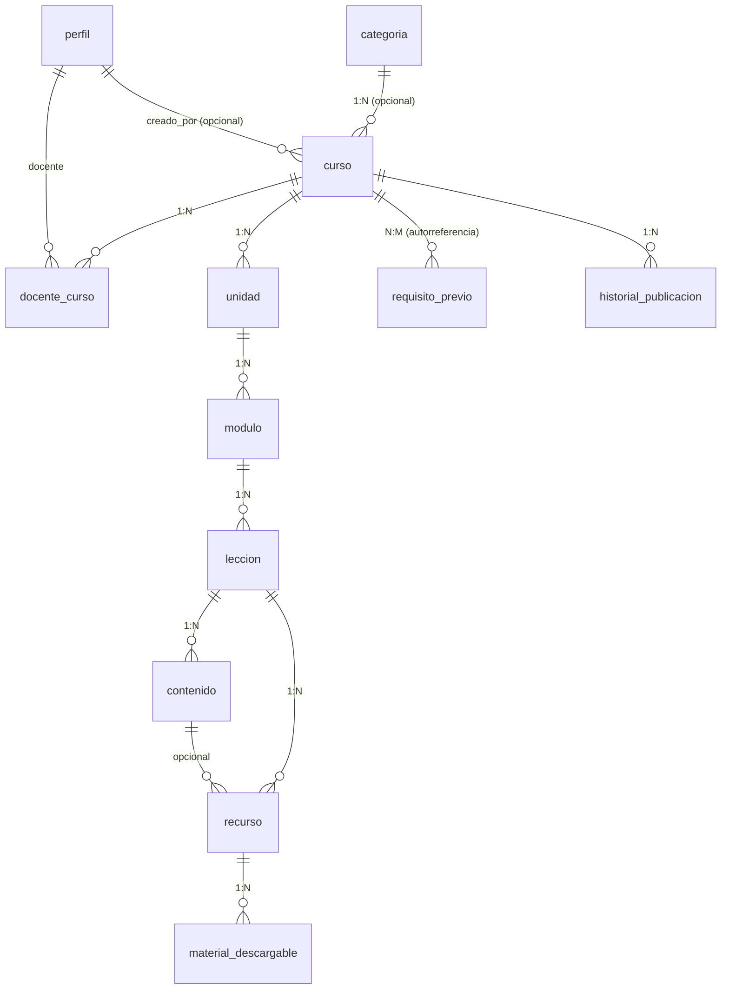
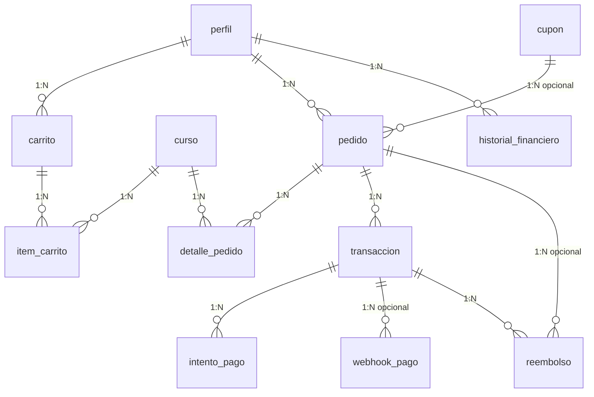

# Relaciones — InkaQuest

Las **206 claves foráneas** del esquema, con su cardinalidad y política de
borrado.

## 1. Políticas de borrado

| Política | Cuándo se usa | Ejemplos |
|---|---|---|
| `CASCADE` | La fila hija no tiene sentido sin la padre | `progreso_leccion` → `progreso_curso`, `opcion` → `pregunta` |
| `SET NULL` | La referencia es informativa o el actor puede desaparecer | `curso.creado_por` → `perfil`, `chatbot_mensaje.autor_id` → `perfil` |
| `RESTRICT` | No se permite borrar si hay referencias (datos financieros) | `transaccion.usuario_id` → `perfil`, `reembolso.transaccion_id` → `transaccion` |
| `NO ACTION` | Comportamiento por defecto de PostgreSQL | — |

**Criterio**: los datos históricos y financieros usan `RESTRICT` para impedir
que se lose la trazabilidad. Los datos de contenido usan `CASCADE` porque son
inherentes a su padre.

## 2. Identidad y autenticación

| Tabla | Referencia | Cardinalidad | Borrado |
|---|---|---|---|
| `perfil` | `auth.users(id)` | 1:1 | CASCADE |
| `solicitud_docente` | `perfil` | N:1 | CASCADE |
| `aprobacion_docente` | `solicitud_docente`, `perfil` (solicitante), `perfil` (decisor) | N:1 | CASCADE / SET NULL |
| `auditoria_acceso` | `perfil` | N:1 | SET NULL |
| `preferencia_usuario` | `perfil` | N:1 | CASCADE |
| `rol_permiso` | `permiso` | N:1 | CASCADE |

`perfil.id` referencia `auth.users.id`: la integridad entre el perfil de
aplicación y la identidad de Supabase está garantizada por la base de datos.

## 3. Catálogo académico

| Relación | FK | Tipo | Borrado |
|---|---|---|---|
| `curso.categoria_id` | → `categoria` | N:1 opcional | SET NULL |
| `curso.creado_por` | → `perfil` | N:1 opcional | SET NULL |
| `docente_curso.curso_id` | → `curso` | N:1 | CASCADE |
| `docente_curso.docente_id` | → `perfil` | N:1 | CASCADE |
| `docente_curso.asignado_por` | → `perfil` | N:1 opcional | SET NULL |
| `unidad.curso_id` | → `curso` | N:1 | CASCADE |
| `modulo.unidad_id` | → `unidad` | N:1 | CASCADE |
| `leccion.modulo_id` | → `modulo` | N:1 | CASCADE |
| `contenido.leccion_id` | → `leccion` | N:1 | CASCADE |
| `recurso.leccion_id` | → `leccion` | N:1 | CASCADE |
| `recurso.contenido_id` | → `contenido` | N:1 opcional | SET NULL |
| `material_descargable.recurso_id` | → `recurso` | N:1 | CASCADE |
| `requisito_previo.curso_id` | → `curso` | N:M | CASCADE |
| `requisito_previo.curso_requisito_id` | → `curso` | N:M | CASCADE |
| `historial_publicacion.curso_id` | → `curso` | N:1 | CASCADE |

**Redundancia deliberada**: `actividad` y `actividad_juego` guardan
`curso_id` además de `leccion_id`. Son consultas frecuentes ("actividades de
un curso") y evitar un JOIN extra en la ruta caliente compensa la
redundancia. La integridad se mantiene porque `curso_id` es coherente con la
lección (verificado por el módulo).

## 4. Matrículas

| Tabla | FK | Tipo | Borrado |
|---|---|---|---|
| `matricula.estudiante_id` | → `perfil` | N:1 | CASCADE |
| `matricula.curso_id` | → `curso` | N:1 | CASCADE |
| `historial_matricula.matricula_id` | → `matricula` | N:1 | CASCADE |
| `historial_matricula.actor_id` | → `perfil` | N:1 opcional | SET NULL |
| `renovacion_matricula.matricula_id` | → `matricula` | N:1 | CASCADE |
| `renovacion_matricula.pago_id` | → `transaccion` | N:1 opcional | SET NULL |
| `cancelacion_matricula.matricula_id` | → `matricula` | N:1 | CASCADE |
| `cancelacion_matricula.reembolso_id` | → `reembolso` | N:1 opcional | SET NULL |
| `acceso_curso.usuario_id` | → `perfil` | N:1 | CASCADE |
| `acceso_curso.curso_id` | → `curso` | N:1 | CASCADE |
| `acceso_curso.matricula_id` | → `matricula` | N:1 opcional | SET NULL |

`unique (estudiante_id, curso_id)` en `matricula` garantiza la relación 1:1
entre estudiante y curso.

## 5. Pagos

| Relación | FK | Tipo | Borrado |
|---|---|---|---|
| `pedido.usuario_id` | → `perfil` | N:1 | **RESTRICT** |
| `detalle_pedido.curso_id` | → `curso` | N:1 | **RESTRICT** |
| `transaccion.usuario_id` | → `perfil` | N:1 | **RESTRICT** |
| `reembolso.transaccion_id` | → `transaccion` | N:1 | **RESTRICT** |
| `reembolso.usuario_id` | → `perfil` | N:1 | **RESTRICT** |
| `compra_virtual.tienda_item_id` | → `tienda_item` | N:1 | **RESTRICT** |
| `envio_reto.lenguaje_id` | → `lenguaje` | N:1 | **RESTRICT** |
| `certificado_curso.curso_id` | → `curso` | N:1 | **RESTRICT** |

Los `RESTRICT` financially son deliberados: no se puede borrar un curso que
fue vendido, ni un usuario que tiene pagos.

## 6. Progreso y evaluaciones

| Tabla | FK | Tipo | Borrado |
|---|---|---|---|
| `progreso_curso.matricula_id` | → `matricula` | 1:1 | CASCADE |
| `progreso_curso.estudiante_id` | → `perfil` | N:1 | CASCADE |
| `progreso_curso.curso_id` | → `curso` | N:1 | CASCADE |
| `progreso_unidad.progreso_curso_id` | → `progreso_curso` | N:1 | CASCADE |
| `progreso_leccion.progreso_curso_id` | → `progreso_curso` | N:1 | CASCADE |
| `progreso_leccion.leccion_id` | → `leccion` | N:1 | CASCADE |
| `actividad.leccion_id` | → `leccion` | N:1 | CASCADE |
| `actividad.curso_id` | → `curso` | N:1 | CASCADE |
| `tarea.actividad_id` | → `actividad` | 1:1 | CASCADE |
| `evaluacion.actividad_id` | → `actividad` | 1:1 | CASCADE |
| `examen.evaluacion_id` | → `evaluacion` | N:1 | CASCADE |
| `pregunta.evaluacion_id` | → `evaluacion` | N:1 | CASCADE |
| `opcion.pregunta_id` | → `pregunta` | N:1 | CASCADE |
| `criterio_evaluacion.evaluacion_id` | → `evaluacion` | N:1 | CASCADE |
| `intento_evaluacion.evaluacion_id` | → `evaluacion` | N:1 | CASCADE |
| `intento_evaluacion.examen_id` | → `examen` | N:1 opcional | SET NULL |
| `respuesta_evaluacion.intento_id` | → `intento_evaluacion` | N:1 | CASCADE |
| `respuesta_evaluacion.pregunta_id` | → `pregunta` | N:1 | CASCADE |
| `respuesta_evaluacion.opcion_id` | → `opcion` | N:1 opcional | SET NULL |
| `entrega.tarea_id` | → `tarea` | N:1 | CASCADE |
| `entrega.estudiante_id` | → `perfil` | N:1 | CASCADE |
| `entrega_archivo.entrega_id` | → `entrega` | N:1 | CASCADE |
| `calificacion.entrega_id` | → `entrega` | N:1 opcional | CASCADE |
| `calificacion.intento_id` | → `intento_evaluacion` | N:1 opcional | CASCADE |
| `calificacion.estudiante_id` | → `perfil` | N:1 | CASCADE |
| `calificacion.docente_id` | → `perfil` | N:1 opcional | SET NULL |
| `retroalimentacion.calificacion_id` | → `calificacion` | N:1 opcional | CASCADE |
| `retroalimentacion.intento_id` | → `intento_evaluacion` | N:1 opcional | CASCADE |
| `retroalimentacion.entrega_id` | → `entrega` | N:1 opcional | CASCADE |

`calificacion` usa `check (num_nonnulls(entrega_id, intento_id) = 1)`: exactamente
una de las dos referencias.

## 7. Retos

| Tabla | FK | Tipo | Borrado |
|---|---|---|---|
| `reto.leccion_id` | → `leccion` | N:1 | CASCADE |
| `reto.curso_id` | → `curso` | N:1 | CASCADE |
| `caso_prueba.reto_id` | → `reto` | N:1 | CASCADE |
| `restriccion_reto.reto_id` | → `reto` | N:1 | CASCADE |
| `envio_reto.reto_id` | → `reto` | N:1 | CASCADE |
| `envio_reto.lenguaje_id` | → `lenguaje` | N:1 | RESTRICT |
| `resultado_caso.envio_id` | → `envio_reto` | N:1 | CASCADE |
| `resultado_caso.caso_prueba_id` | → `caso_prueba` | N:1 | CASCADE |
| `historial_ejecucion.envio_id` | → `envio_reto` | N:1 | CASCADE |

## 8. Minijuegos

| Tabla | FK | Tipo | Borrado |
|---|---|---|---|
| `version_motor.motor_id` | → `motor` | N:1 | CASCADE |
| `motor_comun.motor_id` | → `motor` | 1:1 | CASCADE |
| `motor_curso.motor_id` | → `motor` | N:1 | CASCADE |
| `motor_curso.curso_id` | → `curso` | N:1 | CASCADE |
| `motor_curso.version_motor_id` | → `version_motor` | N:1 opcional | SET NULL |
| `juego.motor_id` | → `motor` | N:1 | CASCADE |
| `juego.version_motor_id` | → `version_motor` | N:1 opcional | SET NULL |
| `configuracion_juego.juego_id` | → `juego` | N:1 | CASCADE |
| `actividad_juego.juego_id` | → `juego` | N:1 | CASCADE |
| `actividad_juego.leccion_id` | → `leccion` | N:1 | CASCADE |
| `actividad_juego.actividad_id` | → `actividad` | N:1 opcional | SET NULL |
| `intento_juego.actividad_juego_id` | → `actividad_juego` | N:1 | CASCADE |
| `respuesta_juego.intento_juego_id` | → `intento_juego` | N:1 | CASCADE |
| `resultado_juego.intento_juego_id` | → `intento_juego` | 1:1 | CASCADE |
| `puntuacion_juego.juego_id` | → `juego` | N:1 | CASCADE |
| `tiempo_juego.intento_juego_id` | → `intento_juego` | N:1 | CASCADE |
| `finalizacion_juego.intento_juego_id` | → `intento_juego` | 1:1 | CASCADE |
| `recompensa_juego.intento_juego_id` | → `intento_juego` | N:1 | CASCADE |

**Jerarquía de motores**: `motor` → `version_motor` → `juego` →
`configuracion_juego` → `actividad_juego` → `intento_juego` → resultados.

## 9. Gamificación

| Tabla | FK | Tipo | Borrado |
|---|---|---|---|
| `transaccion_xp.usuario_id` | → `perfil` | N:1 | CASCADE |
| `insignia_usuario.usuario_id` | → `perfil` | N:1 | CASCADE |
| `insignia_usuario.insignia_id` | → `insignia` | N:1 | CASCADE |
| `requisito_insignia.insignia_id` | → `insignia` | N:1 | CASCADE |
| `requisito_insignia.curso_id` | → `curso` | N:1 opcional | CASCADE |
| `racha.usuario_id` | → `perfil` | 1:1 | CASCADE |
| `historial_racha.usuario_id` | → `perfil` | N:1 | CASCADE |
| `ranking.temporada_id` | → `temporada` | N:1 | CASCADE |
| `ranking.usuario_id` | → `perfil` | N:1 | CASCADE |
| `mision.evento_id` | → `evento_gamificacion` | N:1 opcional | CASCADE |
| `mision.curso_id` | → `curso` | N:1 opcional | CASCADE |
| `mision.insignia_id` | → `insignia` | N:1 opcional | SET NULL |
| `mision_usuario.mision_id` | → `mision` | N:1 | CASCADE |
| `monedero.usuario_id` | → `perfil` | 1:1 | CASCADE |
| `inventario.tienda_item_id` | → `tienda_item` | N:1 | CASCADE |
| `compra_virtual.tienda_item_id` | → `tienda_item` | N:1 | RESTRICT |
| `transaccion_moneda.usuario_id` | → `perfil` | N:1 | CASCADE |

## 10. Certificados, soporte y chatbot

| Tabla | FK | Tipo | Borrado |
|---|---|---|---|
| `certificado_titular.certificado_id` | → `certificado` | N:1 | CASCADE |
| `certificado_titular.usuario_id` | → `perfil` | N:1 | CASCADE |
| `certificado_curso.certificado_id` | → `certificado` | N:1 | CASCADE |
| `certificado_curso.curso_id` | → `curso` | N:1 | RESTRICT |
| `certificado_emision.certificado_id` | → `certificado` | N:1 | CASCADE |
| `certificado_revocacion.certificado_id` | → `certificado` | N:1 | CASCADE |
| `notificacion_destinatario.notificacion_id` | → `notificacion` | N:1 | CASCADE |
| `mensaje.emisor_id` / `destinatario_id` | → `perfil` | N:1 | CASCADE |
| `ticket.usuario_id` | → `perfil` | N:1 | CASCADE |
| `ticket.asignado_a` | → `perfil` | N:1 opcional | SET NULL |
| `ticket_respuesta.ticket_id` | → `ticket` | N:1 | CASCADE |
| `chatbot_mensaje.conversacion_id` | → `chatbot_conversacion` | N:1 | CASCADE |
| `chatbot_fragmento.documento_id` | → `chatbot_documento` | N:1 | CASCADE |
| `chatbot_referencia.mensaje_id` | → `chatbot_mensaje` | N:1 | CASCADE |
| `chatbot_referencia.fragmento_id` | → `chatbot_fragmento` | N:1 opcional | SET NULL |
| `chatbot_derivacion.ticket_id` | → `ticket` | N:1 opcional | SET NULL |
| `chatbot_consumo.usuario_id` | → `perfil` | N:1 opcional | SET NULL |

## 11. Auditoría

| Tabla | FK | Tipo | Borrado |
|---|---|---|---|
| `registro_accion.evento_id` | → `evento_sistema` | N:1 opcional | SET NULL |
| `registro_accion.actor_id` | → `perfil` | N:1 opcional | SET NULL |
| `registro_accion.usuario_objetivo_id` | → `perfil` | N:1 opcional | SET NULL |
| `cambio_administrativo.admin_id` | → `perfil` | N:1 opcional | SET NULL |
| `historial_modificacion.actor_id` | → `perfil` | N:1 opcional | SET NULL |

Las tablas de auditoría usan `SET NULL` en el actor: si se elimina un
usuario, **el registro de auditoría se conserva** (requisito de trazabilidad).

## 12. Reglas de integridad global

| Regla | Implementación |
|---|---|
| Un curso, una matrícula por estudiante | `unique (estudiante_id, curso_id)` |
| Un docente, una responsabilidad por curso | Índice único parcial `uq_docente_curso_responsable` |
| Un intento, un resultado | `unique (intento_juego_id)` en `resultado_juego` |
| Una calificación, un origen | `check (num_nonnulls(entrega_id, intento_id) = 1)` |
| Sin auto-requisito | `check (curso_id <> curso_requisito_id)` |
| Fechas coherentes | `check (fecha_fin > fecha_inicio)`, `check (hasta > desde)` |
| Progreso en rango | `check (porcentaje between 0 and 100)` |
| Importes no negativos | `check (>= 0)` en todas las columnas `numeric` |
| Una palabra clave por idioma | `unique (evaluacion_id, orden)`, `unique (nivel_id, numero)`, etc. |
